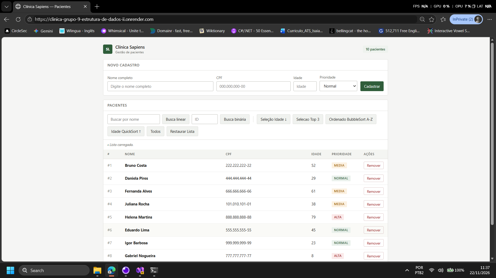
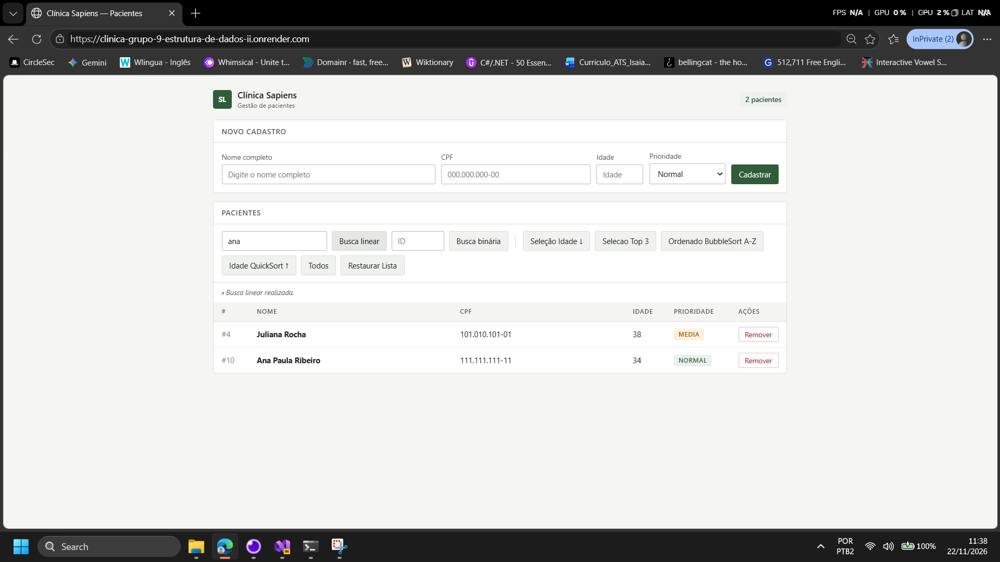
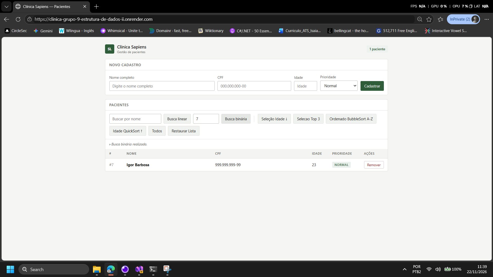
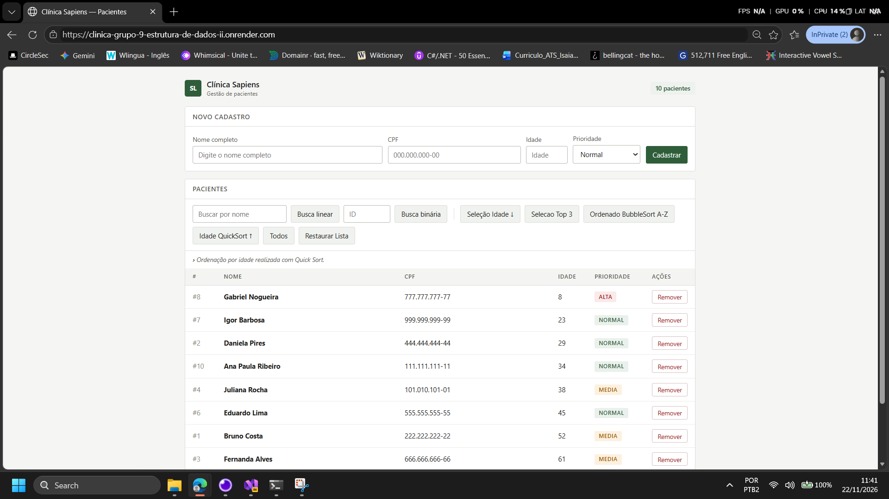
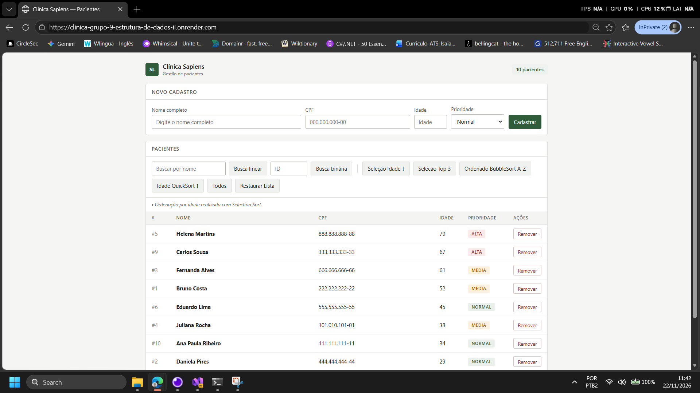
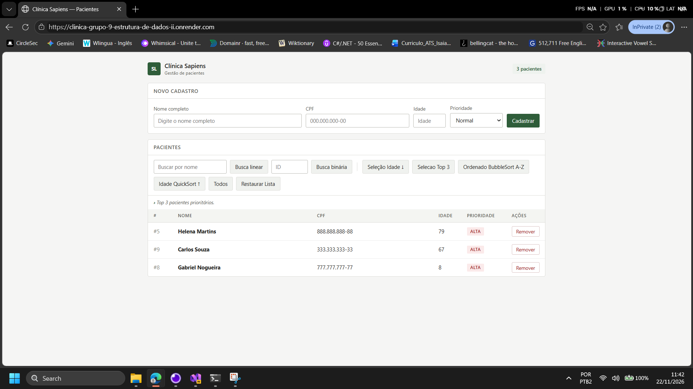
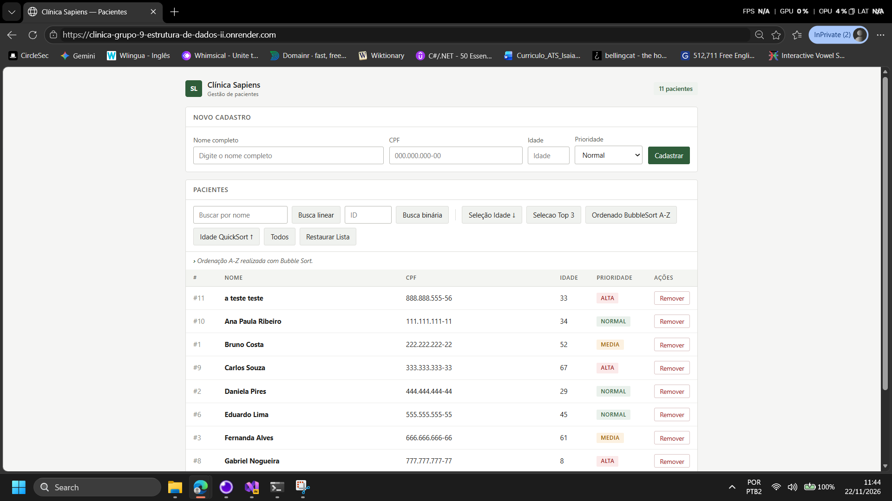

# Clínica Médica – Grupo 9

Projeto da disciplina **Estrutura de Dados II** – Centro Universitário Unisapiens (Porto Velho – RO).
Professora: **Rosângela Silva Cunha**

## Integrantes

| Nome |
|------|
| Isaias de Jesus Barros |
| João Victor Duarte |
| Witalon |

## Resumo

Sistema de cadastro de pacientes de uma clínica médica, desenvolvido em **C# com .NET 10** (ASP.NET Core Web API) e uma interface web simples. Os pacientes ficam em uma **estrutura de dados linear** (lista sequencial, `List<Paciente>`) e sobre ela são aplicados dois algoritmos de cada categoria exigida: **busca**, **ordenação** e **seleção**.

A documentação completa, com introdução, objetivo, desenvolvimento e conclusão (formatação ABNT básica), está em [`docs/Documentacao_ClinicaMedica_Grupo9.pdf`](docs/Documentacao_ClinicaMedica_Grupo9.pdf).

## Algoritmos implementados

| Categoria | Algoritmo | Critério | Complexidade (pior caso) | Arquivo |
|-----------|-----------|----------|--------------------------|---------|
| Busca | Linear | Nome (contém, sem diferenciar maiúsculas) | O(n) | `Algoritmos/Busca.cs` |
| Busca | Binária | Id | O(log n) | `Algoritmos/Busca.cs` |
| Ordenação | Bubble Sort | Nome (A–Z) | O(n²) | `Algoritmos/Ordenacao.cs` |
| Ordenação | Quick Sort | Idade (crescente) | O(n²), médio O(n log n) | `Algoritmos/Ordenacao.cs` |
| Seleção | Selection Sort | Idade (decrescente) | O(n²) | `Algoritmos/Selecao.cs` |
| Seleção | Top 3 prioritários | Prioridade e, no empate, idade | O(k·n), com k = 3 | `Algoritmos/Selecao.cs` |

Todos os algoritmos trabalham sobre uma **cópia** da lista, de modo que a ordem original do cadastro nunca é alterada.

## Estrutura do projeto

```
ClinicaMedicaGrupo9/
├── Model/            Paciente, Prioridade e NovoPaciente
├── Dados/            RepositorioPacientes (lista linear + operações de cadastro)
├── Algoritmos/       Busca, Ordenacao e Selecao
├── Controllers/      ClinicaController (API REST)
├── wwwroot/          Interface web (Index.html, app.js, style.css)
├── Program.cs        Configuração, injeção de dependência e CORS
```

## Aplicação online

A aplicação está publicada em: **[Clínica Sapiens — Pacientes](https://clinica-grupo-9-estrutura-de-dados-ii.onrender.com/)**

> Na hospedagem gratuita, o primeiro acesso pode demorar alguns segundos.

## Como executar

**Requisito:** [.NET SDK 10](https://dotnet.microsoft.com/download).

```bash
cd ClinicaMedicaGrupo9
dotnet run --launch-profile http
```

Abra **http://localhost:5103** no navegador. A API e a interface são servidas pela mesma aplicação.

## Endpoints

Rota base: `/api/clinica`

| Método | Rota | Função |
|--------|------|--------|
| GET | `/buscar/{nome}` | Busca linear por nome |
| GET | `/buscar-binaria/{id}` | Busca binária por Id |
| GET | `/buscar-ordenado-a-z-bubblesort` | Ordenação por nome (Bubble Sort) |
| GET | `/buscar-ordenado-idade-quicksort` | Ordenação por idade (Quick Sort) |
| GET | `/buscar-ordenado-idade-selecao` | Ordenação por idade (Selection Sort) |
| GET | `/buscar-top3-prioritarios-selecao` | Três pacientes mais prioritários |
| GET | `/buscar-todos` | Todos os pacientes, na ordem de cadastro |
| POST | `/incluir-paciente` | Cadastra paciente (rejeita CPF repetido) |
| DELETE | `/remover-paciente/{id}` | Remove paciente |

Exemplo de corpo para `POST /incluir-paciente`:

```json
{ "nome": "Maria Silva", "cpf": "123.456.789-00", "idade": 41, "prioridade": 2 }
```

`prioridade`: `1` = Normal, `2` = Média, `3` = Alta.

## Dados de exemplo

Ao iniciar, a aplicação carrega 10 pacientes (idades de 8 a 79 anos, com as três prioridades), o que permite testar todos os algoritmos sem cadastro prévio. Os dados ficam apenas em memória.

## Testes de execução (prints)

| Teste | Print |
|-------|-------|
| Listagem inicial |  |
| Busca linear ("ana") |  |
| Busca binária (Id 7) |  |
| Bubble Sort A–Z |  |
| Quick Sort por idade |  |
| Selection Sort por idade |  |
| Top 3 prioritários |  |
| Cadastro e CPF repetido |  |

## Tecnologias

C# · .NET 10 · ASP.NET Core Web API · HTML/CSS/JavaScript · Git/GitHub · Render